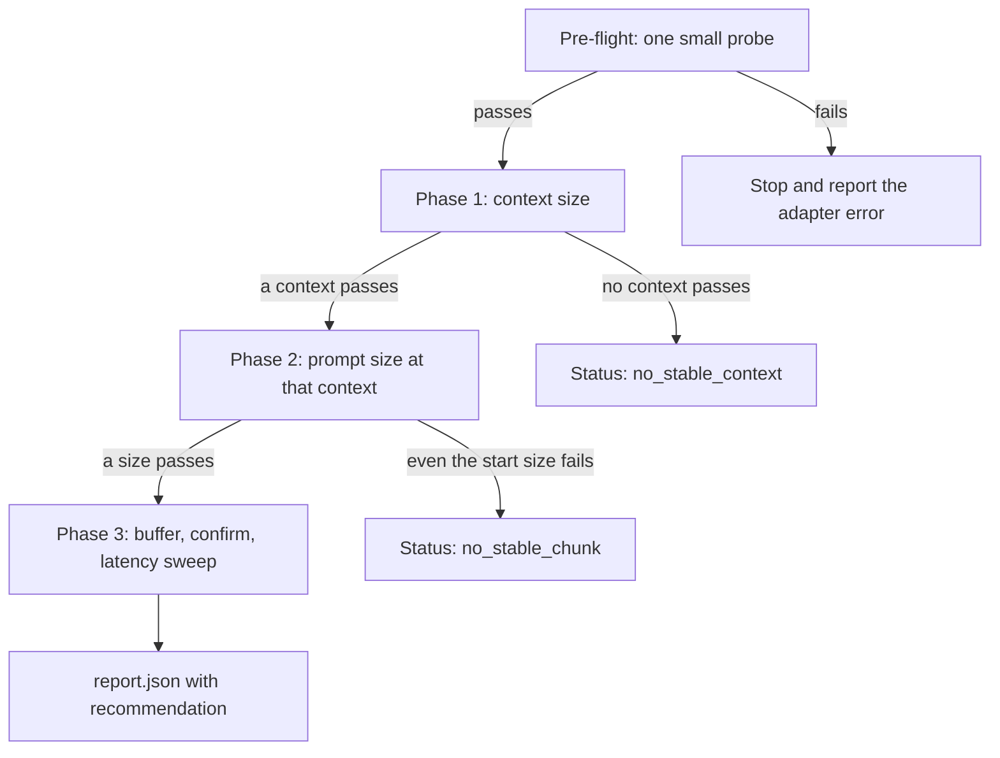
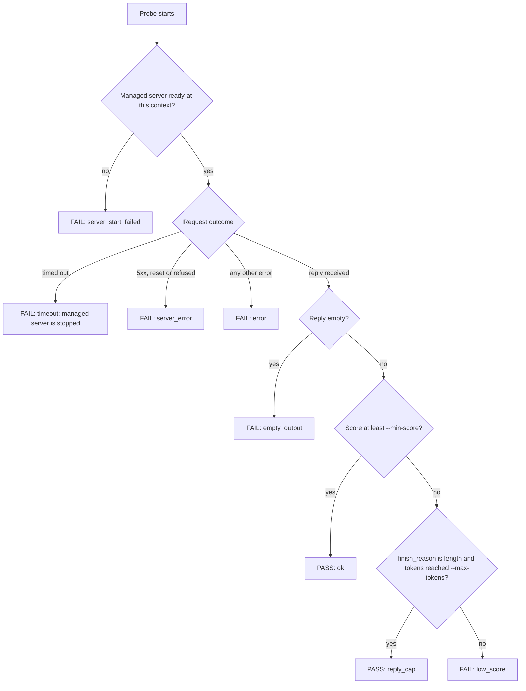

# Auto-tuner

`auto_tuner.py` searches for the largest context size and prompt size that a
local Ollama or llama.cpp model completes within a timeout on the current
machine, applies a safety buffer, and compares the latency of several context
sizes inside that limit. It also records time to first token (TTFT) and decode
speed for each probe. It is a search driver around the existing runtime
adapter: every probe is one real inference request.

```sh
python3 auto_tuner.py --runtime ollama --model llama3.2:1b --ctx-strategy up --max-ctx 16384
```

The tool reports what a model **completed within the configured timeout**. It
does not measure memory consumption, and it does not predict hardware fit. It
records the server's own token counts when they are reported, and checks reply
quality only when `--min-score` is set. See [Scope and
limitations](#scope-and-limitations) before relying on a result.

## Requirements

Python 3.10 or later and a reachable Ollama or llama.cpp server. There are no
third-party dependencies. The probe text is read from a local plain-text file;
`examples/moby_dick_sweep.py fetch` downloads *Moby-Dick* from Project
Gutenberg to `examples/moby_dick.txt`, which is the default `--corpus`.

## Quick start

```sh
python3 examples/moby_dick_sweep.py fetch
cp .env.example .env          # optional; see Configuration
python3 auto_tuner.py --runtime ollama --model llama3.2:1b \
  --ctx-strategy up --max-ctx 16384 --timeout 300
```

Progress is logged to stderr and to `tuner.log`. The final summary is printed
to stdout as JSON; the complete record is written to the run folder.

`--timeout` is the effective limit on CPU-only machines (see [Scope and
limitations](#scope-and-limitations)). Set it to the longest wait that is
acceptable for one request.

For llama.cpp the context is fixed when the server starts, so the tuner must
be given the command that starts it. `{ctx}`, `{port}`, `{host}` and `{model}`
are substituted, and the command is run as an argument list without a shell:

```sh
python3 auto_tuner.py --runtime llama.cpp --model /path/to/model.gguf \
  --server-cmd "llama-server -m {model} -c {ctx} --parallel 1 --no-cache-prompt --host {host} --port {port}" \
  --max-ctx 16384
```

`llama-server` must be on `PATH`; otherwise give its full path in the command.
`--parallel 1` pins a single slot, so that one request owns the whole context and
the automatic slot count of the installed build cannot change the result.
`--no-cache-prompt` disables the server's prompt cache, which would otherwise
shorten repeated prefixes.

To tune prompt size only, against a server that is already running with a known
context:

```sh
python3 auto_tuner.py --runtime llama.cpp --model local --skip-context-search --ctx 8192
```

## Algorithm

Each probe sends a prompt consisting of a fixed instruction (summarise the
excerpt as a JSON object) and an excerpt of the corpus that starts at a random
word offset. Offsets are not reused within a run and the generator is seeded
by `--seed`. The request uses `temperature` 0 and a `max_tokens` limit. By
default the reply is streamed so that TTFT can be measured (see
[Timing metrics](#timing-metrics)).

The search proceeds in order, and stops early if a phase finds nothing:



Every phase decides pass or fail for each probe in the same way. A pass moves
the search towards larger values; a fail moves it towards smaller ones:



A server that stops answering between probes is not a result: the run waits
`--recovery-wait` seconds and then stops with an error.

**Pre-flight.** One small probe is sent at the smallest context. If it fails,
the run stops and reports the adapter's error. For Ollama without
`--server-cmd`, the model name is first checked against the server's model
list. A server that does not respond stops the run before any probe.

**Phase 1: context size.** The prompt is 100 words and the reply limit is 16
tokens, so this phase tests whether the server accepts a given context, not
how much text it can process. When `--min-score` is above 0, the reply limit
for these probes is `--max-tokens` instead, because a JSON reply cannot
complete in 16 tokens.

- `--ctx-strategy down` tries `--max-ctx`, halves on failure until a probe
  passes, then narrows.
- `--ctx-strategy up` starts at `--min-ctx`, doubles until a probe fails or
  `--max-ctx` is reached, then narrows.
- Narrowing tests the midpoint between the last pass and the first failure,
  and stops when the gap is no larger than the greater of one granularity step
  (`--ctx-granularity`) and `--tolerance` times the passing value.
- If `--max-ctx` itself passes, it is reported as the ceiling and
  `first_failing_ctx` is `null`. In that case the figure is the upper bound of
  the search, not a measured limit.

**Phase 2: prompt size.** The context is fixed at the Phase 1 result. Prompt
size starts at `--start-words`, doubles until a probe fails or the prompt plus
the reply limit and `--overhead-tokens` would exceed the context (using
`--tokens-per-word`), then narrows between the last pass and the first failure
with `--word-granularity` and `--tolerance`.

**Phase 3: buffer, confirmation and latency.**

1. The safe prompt size is the Phase 2 result reduced by `--buffer`.
2. The safe size is run `--confirm-repeats` times. On any failure it is
   reduced by `--buffer` again, up to three attempts in total.
3. The smallest context holding the safe prompt plus the reply limit is
   calculated from the token estimate.
4. `--sweep-points` contexts are spaced geometrically between that minimum and
   the Phase 1 ceiling, in ascending order. Each receives one warm-up probe
   with a 100-word prompt, then `--sweep-repeats` probes at the safe size. A
   context with any failed probe is excluded. The reported fastest context has
   the lowest median elapsed time; ties go to the smaller context. When the
   minimum-to-maximum latency ranges of the two quickest contexts overlap, the
   result is marked `fastest_distinguishable: false` and the recommended
   context is the smallest tested context that holds the safe prompt.

The reported usable upper limit is the Phase 1 context together with the safe
prompt size. `recommended_context` gives the context to use for that prompt and
the reason.

### Pass criterion

A probe passes when the request completes and the reply is non-empty, and the
harness score is at least `--min-score` (default 0). By default the tool
therefore measures completion, not correctness. Use `--min-score 1` to require
that the reply parses, with the harness's strict JSON parser, as a JSON object
containing a `summary` key. Markdown code fences are not accepted. A reply that
is cut off by the context is malformed JSON and fails this
check; a prompt that a server silently truncates before the model reads it does
not, because the model can still produce a well-formed reply.

Small models often fail the strict check even when the reply has the right
shape. `--json-mode` asks the server to constrain the reply to well-formed JSON
(Ollama `format: "json"`, llama.cpp `response_format: {"type": "json_object"}`),
so that a malformed reply points to a reply that was cut off rather than to the
model's habits. It does not guarantee that the `summary` key is present.

Failure reasons recorded for each probe:

| Reason | Condition |
| --- | --- |
| `timeout` | The harness timeout expired, or the adapter reported `timed out` |
| `server_error` | The error text contains an HTTP 5xx status, or `closed`, `reset`, `refused`, `terminated`, `killed` or `EOF` |
| `error` | Any other adapter or harness error |
| `empty_output` | The reply was empty |
| `low_score` | The score was below `--min-score` |
| `reply_cap` | Not a failure. The score was below `--min-score`, but the server reported `finish_reason` `length` and the reply reached `--max-tokens`. The incomplete JSON reflects the reply limit, not the context, so the probe counts as passed and is tallied as `reply_cap_probes` in the report. Without a `finish_reason` from the server, such a probe is recorded as `low_score` |
| `server_start_failed` | A managed llama.cpp server did not become ready at that context |

## Timing metrics

With `--ttft` (the default) the adapter is run with `--stream`, which requests a
streamed reply from Ollama (`/api/chat`, newline-delimited JSON) or llama.cpp
(`/v1/chat/completions`, server-sent events) and adds two fields to its
response. Each probe record and the sweep rows carry the derived values.

| Metric | Definition |
| --- | --- |
| `ttft` | Seconds from the adapter sending the request to the arrival of the first non-empty text chunk. It includes connection, queueing, model loading if the model is not resident, and prompt processing. It excludes Python start-up |
| `decode_tps` | `(output_tokens - 1) / (last text chunk - first text chunk)`. Needs the server's own token count: Ollama `eval_count`, or llama.cpp `usage.completion_tokens` (requested with `stream_options.include_usage`). Omitted when the count is missing or below 2 |
| `elapsed` | Whole-probe wall-clock time as measured by the harness, including adapter start-up |
| `prompt_tokens` | The server's own count of prompt tokens (Ollama `prompt_eval_count`, llama.cpp `usage.prompt_tokens`). Ollama may report fewer when it reuses a cached prompt prefix. The report's `token_estimate` gives the median ratio of actual to estimated tokens |
| `finish_reason` | The server's stop reason (`stop` or `length`) |
| `median_end_to_end_tokens_per_second` | `output_tokens / elapsed`, which includes prompt processing. It is not a decode speed |

The Phase 2 result lists `ttft_by_words` for the probes that passed. The Phase
3 sweep rows list median TTFT, median decode speed and the minimum and maximum
latency for each context.

A probe that follows a context change, or the first probe of a run, includes
model loading in its TTFT. The sweep sends a warm-up probe before the timed
probes at each context for this reason. The Phase 2 search has no warm-up, so
its TTFT values at the first size may include loading.

TTFT is measured only for Ollama and llama.cpp. `--stream` is rejected for
Colibri and AirLLM and for embedding requests.

## Safeguards

| Safeguard | Behaviour |
| --- | --- |
| Probe and time budget | The run stops after `--max-probes` probes or `--max-minutes` minutes |
| Resource floor | Before each probe, the run stops if `MemAvailable` is below `--min-free-mem-mb` (Linux only) or free disk in the output location is below `--min-free-disk-mb` |
| Per-probe timeout | `--timeout` seconds, applied in the adapter and, with a 30 second margin, in the harness subprocess |
| Cooldown | `--cooldown` seconds are waited after a failed probe |
| Server availability | If an unmanaged server does not answer, the run waits `--recovery-wait` seconds and then stops with an error rather than recording the missing server as a capacity result |
| Managed server | With `--server-cmd`, the server is restarted when the context changes or the process has exited, stopped after a timeout, and stopped on exit. The tuner refuses to start if another server already answers on the endpoint |
| Advertised maximum cap | A context advertised by the model is capped at `--hard-ctx-cap`. An explicit `--max-ctx` is not capped |
| Durable log | Each probe is appended to `probes.jsonl` and synchronised to disk before the next probe |
| No database | The tuner does not open the benchmark SQLite database |
| Interruption | `SIGTERM` and Ctrl-C stop the run, stop any managed server and write `report.json` |

Prompt text is not stored; each record holds the corpus offset and word count.
The first 160 characters of each reply are stored as `reply_preview`.

## Output

Each run creates `<output-dir>/<runtime>-<model>-<timestamp>/`:

| File | Content |
| --- | --- |
| `report.json` | Settings, machine information, phase results, recommendation and all probes |
| `probes.jsonl` | One JSON record per probe |
| `tuner.log` | Full log at DEBUG level |
| `server-NN-ctxN.log` | Server output for each start (only with `--server-cmd`) |

`--resume <run folder>` reloads `probes.jsonl`. A probe whose phase, tag,
context, word count and reply limit match an earlier record is not repeated.
Stopped and failed runs also write `report.json`, with a `status` field.

Exit codes as implemented: `0` completed; `1` error or a safeguard stopped the
run; `2` finished with no stable context or prompt size; `130` interrupted.

## Configuration

Defaults can be supplied by environment variables named `TUNER_` followed by
the option name in capitals with underscores (for example `TUNER_MAX_CTX`), or
by a `KEY=VALUE` file (`.env` by default, or `--env-file`). Values already set
in the environment are not overridden by the file. Command-line options take
precedence. `.env.example` lists the variables. `--resume` and `--env-file`
cannot be set this way.

| Option | Default | Description |
| --- | --- | --- |
| `--runtime`, `--model` | required | `ollama` or `llama.cpp`; model name or path |
| `--endpoint` | runtime default | Server base URL |
| `--server-cmd` | none | Command template that starts the server |
| `--server-start-timeout` | 180 | Seconds to wait for a managed server |
| `--min-ctx`, `--max-ctx` | 2048, advertised maximum | Context search range |
| `--hard-ctx-cap` | 65536 | Cap on an advertised maximum |
| `--ctx-strategy` | `down` | `down` or `up` |
| `--ctx`, `--skip-context-search` | none | Skip Phase 1 and use a fixed context |
| `--ctx-granularity` | 256 | Context rounding step |
| `--probe-words`, `--probe-max-tokens` | 100, 16 | Prompt and reply size for context probes |
| `--start-words`, `--word-granularity` | 500, 50 | Phase 2 starting size and rounding step |
| `--max-tokens` | 200 | Reply limit reserved inside the context |
| `--tokens-per-word`, `--overhead-tokens` | 1.5, 64 | Token estimate parameters |
| `--tolerance` | 0.05 | Narrowing stops below this fraction of the passing value |
| `--buffer` | 0.10 | Reduction applied to the largest passing prompt |
| `--confirm-repeats` | 2 | Confirmation probes at the safe size |
| `--sweep-points`, `--sweep-repeats` | 4, 3 | Latency sweep contexts and repeats per context |
| `--min-score` | 0 | Minimum harness score for a pass |
| `--json-mode` | off | Constrain replies to well-formed JSON (Ollama, llama.cpp) |
| `--timeout` | 300 | Seconds per probe |
| `--max-probes`, `--max-minutes` | 80, 240 | Run budget |
| `--min-free-mem-mb`, `--min-free-disk-mb` | 300, 1024 | Resource floors |
| `--cooldown`, `--recovery-wait` | 5, 60 | Seconds after a failure; seconds to wait for a server |
| `--seed` | 42 | Seed for excerpt selection |
| `--ttft`, `--no-ttft` | on | Stream replies to record TTFT and decode speed |
| `--corpus` | `examples/moby_dick.txt` | Plain-text source of excerpts |
| `--output-dir`, `--resume` | `tuning_runs` | Run folder parent; run folder to continue |
| `--log-level` | `INFO` | Console level; the file log is always DEBUG |

Runtime differences:

| | Ollama | llama.cpp |
| --- | --- | --- |
| Context | Sent per request (`num_ctx`) | Fixed at server start; requires `--server-cmd` or `--skip-context-search` |
| Advertised maximum | Read through the adapter's `context_defaults` when the source is Ollama metadata | Read from `/v1/models` `meta.n_ctx_train` if present |

If no maximum can be found, `--max-ctx` is required. Ollama reserves memory in
proportion to its number of parallel requests, so `OLLAMA_NUM_PARALLEL=1` is
advisable when interpreting results.

## Verification status

| Capability | Status |
| --- | --- |
| Halving, doubling and midpoint narrowing; both context strategies; granularity and non-termination edge cases | Unit-tested against a simulated server. `down` ran against Ollama and `up` against llama.cpp; halving after a failed first attempt has not run against a real server, because the largest context passed each time |
| Failure classification, including adapter timeouts and `reply_cap` | Unit-tested, including a test that fails when the `reply_cap` rule is removed. All of `ok`, `reply_cap` and `timeout` occurred in the real runs and were classified as described |
| Settings validation; `.env` loading; missing-model error; exit codes `0`, `1` and `2` | Unit-tested |
| Probe budget stop, partial report, resume from `probes.jsonl` | Unit-tested |
| Pre-flight failure on an unreachable server or a failing smoke probe | Unit-tested |
| Mid-run server loss stops the run and writes a report | Unit-tested with a simulated server |
| Distinct excerpt for every probe | Unit-tested |
| Streaming, TTFT, `prompt_tokens` and `finish_reason` for the Ollama and llama.cpp response formats; stream errors; whole-exchange timeout; rejection for other runtimes | Unit-tested against a local HTTP server that imitates each format, and exercised in the real runs on both runtimes |
| `--json-mode` field mapping and rejection of other values and of Colibri | Unit-tested. Exercised in the real runs on both runtimes (see below) |
| Distinguishable-latency rule and `recommended_context` | Unit-tested. Both real runs reported `fastest_distinguishable: false` |
| Managed server lifecycle (`--server-cmd`): start, reuse, restart on context change or exit, start failures | Unit-tested with real child processes. In the llama.cpp run the server was restarted for each context change and after each of the three timeouts |
| Advertised-maximum discovery | Unit-tested with simulated servers. Not exercised in the real runs, because `--max-ctx` was supplied |
| `--hard-ctx-cap` | Implemented; not exercised |
| Memory and disk floors | Evaluated before every probe in the real runs without triggering. The stop itself is not exercised |
| `--recovery-wait` and `SIGTERM` handling | Implemented; not exercised |
| `--skip-context-search` | Exercised against Ollama in short runs; not against llama.cpp |
| Python 3.10 | Not run locally; the CI matrix covers it |

### Observed run: Ollama

`llama3.2:1b` on Ollama, WSL2 on an Intel Core i5-1235U (12 logical CPUs).
Options: `--ctx-strategy down --max-ctx 32768 --timeout 120 --max-tokens 200
--min-score 1 --json-mode`. The run made 29 probes in about 36 minutes.

| Phase | Result |
| --- | --- |
| 1 | 32768 passed on the first attempt. That is the search limit, not a measured failure point |
| 2 | 500, 1000 and 2000 words passed in 28.4, 47.1 and 102.1 s (TTFT 20.2, 39.2 and 90.8 s). 4000, 3000, 2500 and 2250 words timed out at 120 s. 2100 and 2150 words passed in 96.6 and 112.2 s. Reported maximum: 2150 words (3147 prompt tokens by the server's count) |
| 3 | Safe prompt 1900 words (2914 tokens by estimate). Two confirmation probes passed (83.7 and 80.9 s) |

Phase 3 latency, three probes per context:

| Context | Median total (s) | Range (s) | Median TTFT (s) | Median decode (tok/s) |
| --- | --- | --- | --- | --- |
| 3328 | 76.5 | 72.6 - 76.8 | 71.5 | 9.4 |
| 7168 | 82.0 | 75.5 - 97.2 | 76.2 | 9.4 |
| 15360 | 84.1 | 72.1 - 94.2 | 77.8 | 9.3 |
| 32768 | 85.1 | 84.9 - 89.2 | 81.7 | 9.0 |

The report gave `fastest_distinguishable: false` and recommended context 3328,
the smallest tested context that holds the prompt. All 25 probes that completed
parsed as a JSON object with a `summary` key. No probe was a `reply_cap`. The
four timeouts account for 8 of the 36 minutes.

### Observed run: llama.cpp

Qwen2.5 0.5B Instruct Q8_0 on llama.cpp build 11638, same machine. The server
was started by the tuner with `--parallel 1 --no-cache-prompt`. Options:
`--ctx-strategy up --max-ctx 32768 --timeout 120 --max-tokens 200 --min-score 1
--json-mode`. The run made 33 probes in about 39 minutes.

| Phase | Result |
| --- | --- |
| 1 | Every context from 2048 to 32768 passed. 32768 is the search limit, not a measured failure point |
| 2 | 500, 1000, 2000 and 4000 words passed. 8000 and 6000 words timed out at 120 s. 5000 words passed in 82.3 s, 5500 words in 116.7 s and 5750 words in 118.8 s. Reported maximum: 5750 words (7979 prompt tokens by the server's count) |
| 3 | Safe prompt 5150 words (7789 tokens by estimate). Two confirmation probes passed (107.3 and 101.5 s) |

Phase 3 latency, three probes per context:

| Context | Median total (s) | Range (s) | Median TTFT (s) | Median decode (tok/s) |
| --- | --- | --- | --- | --- |
| 8192 | 106.5 | 105.3 - 114.1 | 96.3 | 14.3 |
| 13056 | 99.0 | 98.2 - 106.8 | 90.4 | 15.4 |
| 20736 | not stable | one probe timed out at 120.2 s; the others took 102.7 and 107.9 s | | |
| 32768 | 105.7 | 96.8 - 117.7 | 93.1 | 12.2 |

The report gave `fastest_distinguishable: false` and recommended context 8192.
Eleven of the 33 probes were `reply_cap`: each had `finish_reason` `length` and
exactly 200 tokens, and each began as well-formed JSON. No probe was recorded as
`low_score`. All 19 replies that finished on their own parsed as a JSON object
with a `summary` key.

### What the runs show

- **The limit found is a time limit.** Every Phase 2 failure in both runs was
  the 120 second timeout. Neither run found a memory limit: no probe failed
  because of memory at contexts up to 32768, and the Phase 1 results are the
  search limit.
- **Prompt processing dominates.** For prompts of 1000 words or more, TTFT was
  between about 77% and 99% of the total time on both runtimes.
- **The boundary is close to the timeout.** The largest passing prompts took
  112 to 119 s. In the llama.cpp run the safe prompts took 97 to 118 s, and one
  of them timed out at 120.2 s. The buffer reduces the number of words, not the
  time, so a safe prompt can still be within a few seconds of the timeout.
- **Reply length moves the boundary.** A `reply_cap` probe generates 200 tokens,
  about 13 s at 15 tok/s on llama.cpp, so the boundary depends in part on reply
  length.
- **Latency does not separate the contexts.** Within each run the ranges of the
  contexts overlap, so neither run shows that any context is faster. The
  recommended context is therefore the smallest one that holds the prompt.
- **The token estimate is slightly high.** The server's prompt token count was
  a median of 0.93 (Ollama, 25 probes) and 0.94 (llama.cpp, 30 probes) of the
  estimate, in a range of 0.85 to 1.09. Ollama may report fewer tokens when it
  reuses a cached prompt prefix.
- **`--json-mode` worked on both runtimes.** Every reply that finished
  parsed, and the replies that did not parse were cut off by the reply limit.
  An earlier Ollama run without `--json-mode` scored 0 on 26 of 27 completed
  probes.

## Scope and limitations

The tool does **not**:

- measure RAM, VRAM, KV-cache size, or detect an out-of-memory condition other
  than through a failed or timed-out request;
- read actual prompt token counts into the search. The limit calculation uses a
  word-based estimate (`--tokens-per-word`); actual counts are only recorded
  and compared with the estimate when the server reports them;
- evaluate the quality of replies beyond the optional JSON check, and it
  stores only a 160-character reply preview;
- distinguish a timeout caused by memory pressure from one caused by slow
  prompt processing, or a server that has stopped responding from a model that
  is slow. Both are recorded as `timeout`. A managed llama.cpp server is
  stopped and restarted after a timeout; an unmanaged server is not;
- separate server-side prompt processing from queueing and model loading
  inside TTFT, or report inter-token latency;
- establish statistical significance. Latency comparisons use the median of
  `--sweep-repeats` probes, run in ascending context order and not randomised,
  so drift during a run is not separated from the effect of the context;
- test concurrent requests, GPU or VRAM behaviour, or runtimes other than
  Ollama and llama.cpp;
- test contexts above `--max-ctx`, or above the cap applied to an advertised
  maximum;
- remove prompt-cache effects. Varying the excerpt reduces them.

Further notes:

- `--timeout` is the effective limit on CPU-only machines. A probe is only
  recorded as a failure after the full timeout has elapsed, so a long timeout
  makes every failing probe expensive. Set it to the longest wait that is
  acceptable.
- The search assumes that a larger value is not easier to complete than a
  smaller one. A non-monotonic result is reported at the boundary the search
  encountered.
- Each probe's `max_tokens` is reserved inside the context. A reply that
  reaches the limit (11 of 33 probes in the llama.cpp run) lengthens that
  probe's latency and is recorded as `reply_cap`.
- The `--buffer` reduces the prompt in words. It does not leave headroom in
  time, and prompt processing time grows faster than the word count, so a safe
  prompt can still finish close to `--timeout`.
- The timeout is the limit on total time, including the reply. It is enforced
  as each streamed line arrives and by the socket read timeout, so a probe
  that completes just after the limit is a failure. Recorded times include
  about half a second of adapter start-up.
- The first request at a new context includes model loading, which is why a
  warm-up precedes each sweep context.
- The tool cannot prevent an operating system out-of-memory event. On small
  machines use `--ctx-strategy up` and a bounded `--max-ctx`.
- Under WSL, `df` reports the size of the virtual disk, not the free space on
  the Windows drive that hosts it. The disk floor therefore cannot detect a
  full Windows drive.

## Tests

```sh
python3 -m unittest tests.test_auto_tuner
```

The tests use simulated servers and do not require a model. The managed-server
tests start real child processes and are skipped on Windows.
